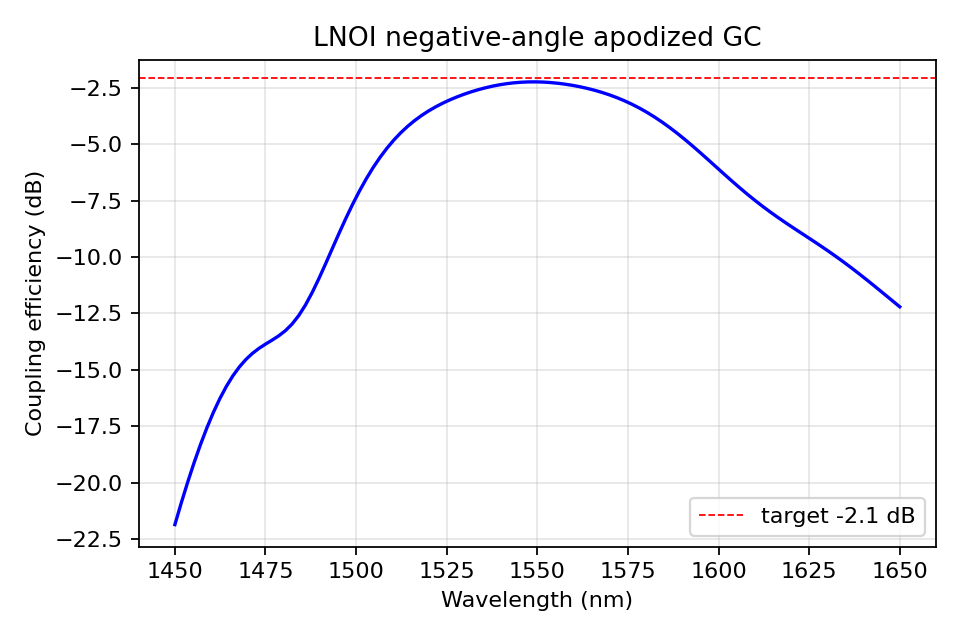

# TFLN Negative-Angle Grating Coupler Reproduction

Reproducible 2D-FDTD model of the X-cut thin-film lithium-niobate (TFLN) apodized grating coupler reported by Liao *et al.* in *Optics Express* 32(26), 46299 (2024), DOI: [10.1364/OE.542031](https://doi.org/10.1364/OE.542031).

## Reproduction status

The reproduction is complete at the 2D simulation level.

| Metric | Paper | This repository |
|---|---:|---:|
| Peak coupling efficiency | -2.1 dB (61.6%) | **-2.25 dB (59.6%)** |
| Peak wavelength | 1552 nm | **1549.5 nm** |
| 3 dB bandwidth | about 80 nm | **86.8 nm** |
| Substrate leakage | about 25% | **21.6%** |

The peak-efficiency difference is 0.15 dB. Mesh refinement at 15, 12, and 10 nm gave the same reported peak value. See [SIMULATION_REPORT.md](SIMULATION_REPORT.md) for the model assumptions, convergence checks, and comparison with the paper.



## Model highlights

- X-cut LN with an anisotropic, dispersive material model.
- 600 nm LN film, 425 nm etch, 4.7 µm BOX, and Si substrate.
- Negative-angle coupling implemented with the Lumerical angle convention.
- Fundamental guided-mode power extracted with a mode-expansion monitor.
- Si substrate and BOX Fabry-Pérot phase retained; no bottom metal mirror.

## Requirements

- Python 3.10 or newer
- NumPy and Matplotlib
- A licensed Ansys Lumerical FDTD installation with `lumapi`

Set these optional environment variables when Lumerical is not installed at the script's default Windows location:

```powershell
$env:LUMERICAL_ROOT = 'C:\Program Files\Lumerical\v252'
$env:LUMAPI_DIR = "$env:LUMERICAL_ROOT\api\python"
$env:LUMERICAL_ENGINE = "$env:LUMERICAL_ROOT\bin\fdtd-engine.exe"
```

Run the model from the repository root:

```powershell
python grating_coupler_fdtd.py --build-only
python grating_coupler_fdtd.py --quick
python grating_coupler_fdtd.py
```

The `.fsp` file is intentionally not versioned because it is generated by the script and is large. Published CSV and PNG outputs are kept in `results/` so the reported result can be inspected without Lumerical.

## Citation and licensing

If this repository is useful, cite both the original paper and this repository; metadata is provided in [CITATION.cff](CITATION.cff). The repository code is released under the [MIT License](LICENSE). Ansys Lumerical is proprietary software and is not distributed here.
