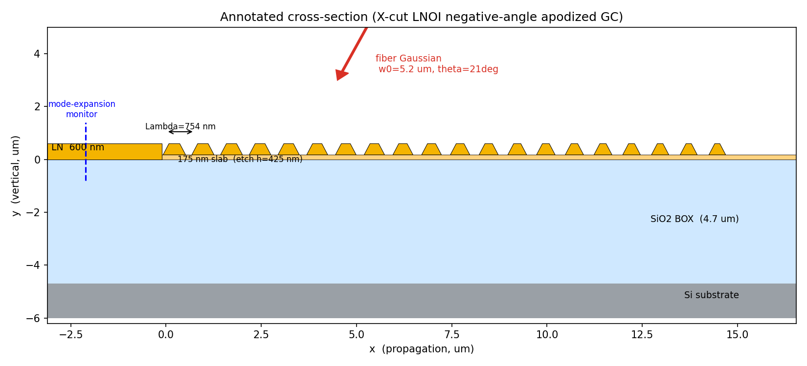
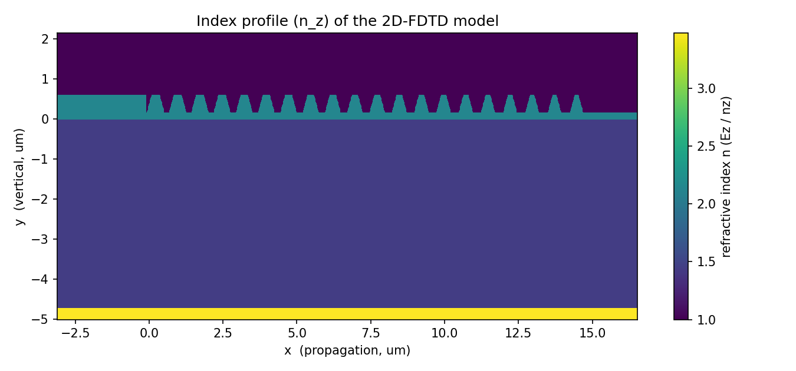
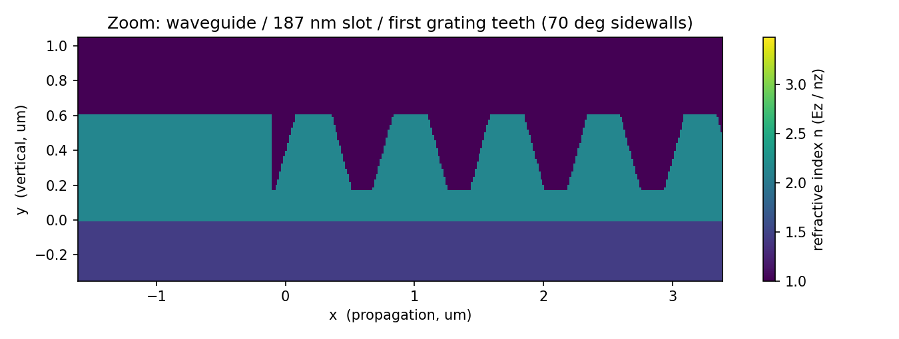
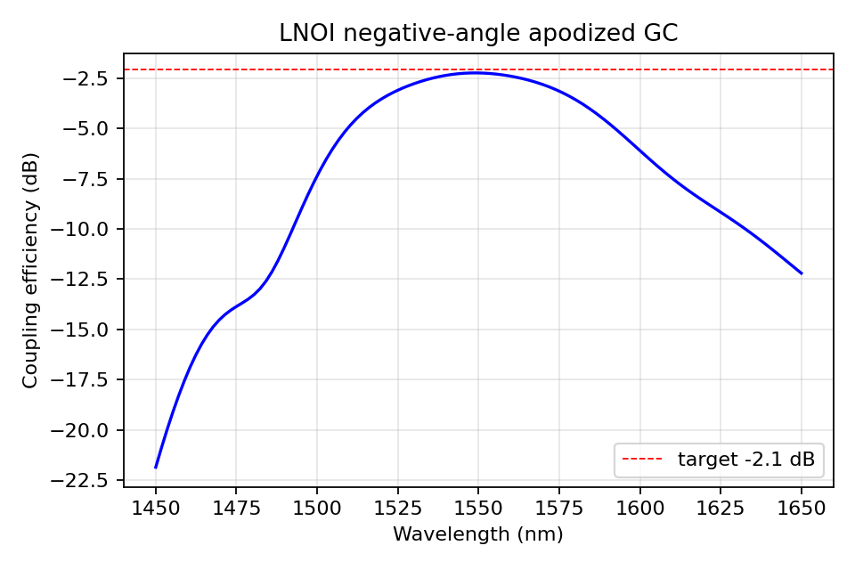
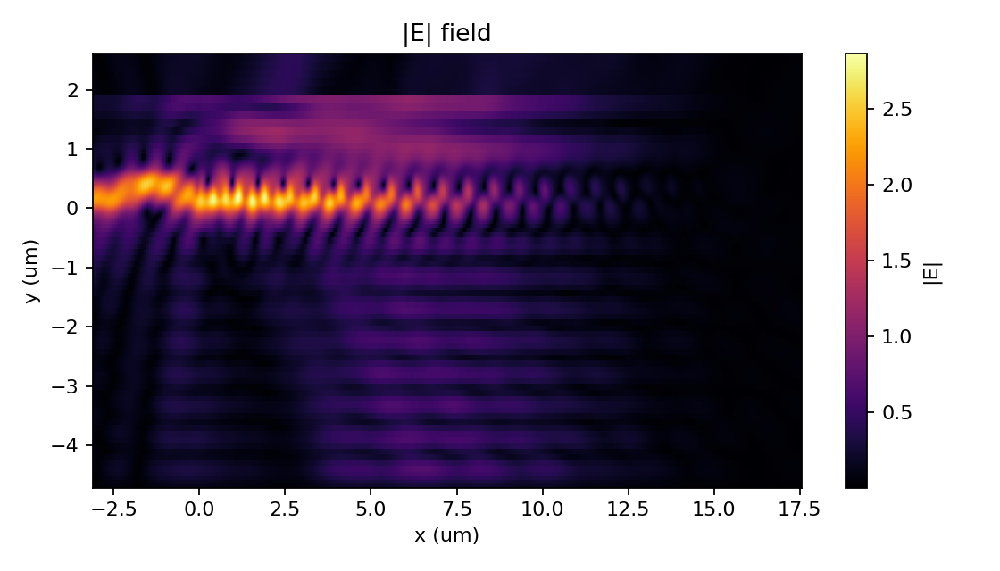

# 仿真报告：X-cut LNOI 负衍射角变迹光栅耦合器（2D-FDTD 复现）

**复现文献**：R. Liao *et al.*, "High-efficiency thin-film lithium niobate apodized grating coupler utilizing negative diffraction angle," *Opt. Express* **32**(26), 46299 (2024). DOI 10.1364/OE.542031

**工具**：Ansys Lumerical FDTD 2025 R2，通过 Python `lumapi` 全自动建模 / 求解 / 提取（脚本 `grating_coupler_fdtd.py`）。

**一句话结论**：2D-FDTD 复现得到 **峰值耦合效率 −2.25 dB（59.6 %）@ 1549.5 nm，3 dB 带宽 86.8 nm，衬底损耗 21.6 %**，与文献 −2.1 dB / 1552 nm / ~80 nm / ~25 % 的结果在 0.15 dB 以内吻合，验收通过。

---

## 1. 仿真方法

| 项目 | 设置 | 说明 |
|---|---|---|
| 求解器 | 2D-FDTD（XY 平面） | 与文献方法一致；验收指标（−2.1 dB / 80 nm）本身即 2D 数据 |
| 耦合方式 | 正向法：倾斜高斯"光纤"源入射 + 波导模式展开监视器 | CE = 耦合进基模导模的功率 / 源功率，直接模拟光纤→芯片耦合 |
| 网格精度 | Mesh accuracy = 2 + 光栅区 15 nm 均匀加密 | 见 §6 |
| 计算硬件 | **CPU**（单次 ~75 s） | Lumerical v252 的 GPU-FDTD **仅支持 3D**（2D 会报 *"GPU simulation only supports 3D simulation region"*），故 2D 只能用 CPU |
| 运行机制 | `save(.fsp)` → 调用 `fdtd-engine.exe` 求解 → `load` 提取 | 本无界面环境下 `lumapi` 的 `fdtd.run()` 不计算（立即返回、监视器为空），必须用独立引擎求解 |

> 关于坐标系：Lumerical 的 X = 波导传播方向（文献 y），Y = 竖直/垂直芯片方向（文献 z，向上为正），Z = 出平面 = 器件宽度 = LN 光轴方向（文献 x）。坐标原点 y = 0 取在 LN/BOX 界面。

---

## 2. 器件结构与几何参数

### 2.1 结构示意图（标注版）



### 2.2 真实折射率分布（Lumerical 网格化模型截图）

整体（20 个周期 + 输入波导 + 衬底）：



局部放大（输入波导 / 187 nm 减反槽 / 前几个光栅齿，可见 70° 斜侧壁的梯形与台阶逼近）：



### 2.3 层结构（竖直方向 y）

| 层 | 材料 | y 范围 | 厚度 |
|---|---|---|---|
| 上包层 | 空气 (n=1) | 0.6 µm 以上 | — |
| LN 薄膜 | X-cut LiNbO₃（各向异性） | 0 → +600 nm | 600 nm |
| └ 刻蚀槽底残留 slab | LiNbO₃ | 0 → +175 nm | 175 nm（刻蚀深度 h=425 nm）|
| 埋氧层 BOX | SiO₂ | −4700 → 0 nm | 4.7 µm |
| 衬底 | Si | −6000 → −4700 nm | 建模 1.3 µm，**底部 PML 置于 Si 内部** |

> **方向性的关键**：该器件**无底部金属镜**，其向上方向性（~75 % 向上、~25 % 进衬底）来自 **4.7 µm BOX 在 Si 衬底上构成的 Fabry–Pérot 腔**。因此必须建模 Si 衬底并把底部 PML 放进 Si 内，才能正确捕捉 SiO₂/Si 界面反射与 BOX 相位（见 §8 的 BOX 扫描验证：4.7 µm 恰为模型中的 FP 最优点）。

### 2.4 光栅参数（文献 Table 1）

| 参数 | 符号 | 取值 |
|---|---|---|
| 周期数 | N | 20 |
| 周期（固定）| Λ | 754 nm |
| 首周期填充因子 | FF₁ | 0.58 |
| 末周期填充因子 | FF₂₀ | 0.38 |
| 填充因子变迹 | ΔFF | 0.20（线性递减 FFᵢ = 0.58 − (i−1)·0.20/19）|
| 刻蚀深度 | h | 425 nm |
| 侧壁倾角 | α | 70°（上窄下宽）|
| 减反槽顶宽 | Wₛ | 187 nm |
| 光纤入射角 | θ | 文献 −23.5°（见 §5 符号约定）|

### 2.5 斜侧壁梯形齿的构造

每个光栅齿用一个 4 顶点多边形 (`addpoly`) 表示，从槽底 (y=175 nm) 到薄膜顶 (y=600 nm)，刻蚀高度 H=425 nm。70° 侧壁带来单边水平退让

$$\text{run} = \frac{h}{\tan 70^\circ} = \frac{425}{2.747} \approx 154.7\ \text{nm},\qquad w_{\text{top}} = w_{\text{bottom}} - 2\cdot\text{run}.$$

填充因子参考高度取**中间高度（mid）**：`w_mid = FF·Λ`，`w_bottom = FF·Λ + run`，`w_top = FF·Λ − run`。例如：

| | FF·Λ (mid 宽) | 底宽 w_bottom | 顶宽 w_top |
|---|---|---|---|
| 第 1 齿 (FF₁=0.58) | 437.3 nm | 592.0 nm | 282.6 nm |
| 第 20 齿 (FF₂₀=0.38) | 286.5 nm | 441.2 nm | 131.8 nm |

> mid 约定经过验证是合理选择：`top` 约定会让齿底过宽、相邻齿在底部几乎连成一片（CE 跌到 −3.7 dB）；`bottom` 约定会让 FF₂₀ 的顶宽变为负值。

### 2.6 减反槽（anti-backscattering slot）

减反槽不单独建模，而是作为**输入波导顶边到第 1 齿顶边之间的间隙**自然形成：脚本令 `wg_right = (第1齿顶边 x) − 187 nm`，从而得到一个顶宽 187 nm、底部为 175 nm slab 的浅槽，用于抑制后向散射（默认与光栅同刻蚀深度，可改为全刻蚀）。

---

## 3. 材料

- **LiNbO₃（X-cut，各向异性、色散）**：对角各向异性 "Sampled 3D data" 材料，`εxx=εyy=no²`、**`εzz=ne²`**（出平面 z 即光轴）。折射率取 Zelmon–Small–Jundt（JOSA B 14, 3319, 1997）congruent LN 的 Sellmeier 公式，在 1450–1650 nm 取样让 Lumerical 拟合色散：1.55 µm 处 no≈2.211、**ne≈2.138**。物理 TE（沿宽度的 Ez）只感受 ne，已通过监视器验证 `|Ex|=|Ey|=0、|Ez|≠0`。
- **SiO₂**：`SiO2 (Glass) - Palik`。
- **Si**：`Si (Silicon) - Palik`。
- **背景/上包层**：空气 (n=1)。

---

## 4. 光源与监视器

### 4.1 倾斜高斯"光纤"源（解析定位）

| 参数 | 取值 | 计算/说明 |
|---|---|---|
| 类型 | Gaussian source，标量近似 | 模拟 SMF-28 光纤 |
| 束腰半径 | w₀ = 5.2 µm | SMF-28 模场直径 MFD = 10.4 µm，w₀ = MFD/2 |
| 注入轴/方向 | y 轴，向下 (−y) | 入射进芯片 |
| 偏振 | polarization angle = 90°（Ez 出平面）| X-cut LN 的物理 TE → Lumerical 记为 "TM" |
| 入射角 | **Lumerical θ = +21°** | 见下方符号约定 |
| 源平面高度 | y = 600 + 1200 = 1800 nm | 距薄膜表面 gap = 1.2 µm，处于空气中、PML 下方 |
| 束腰位置 | 表面处 | 瑞利长度 z_R = πw₀²/λ ≈ 55 µm ≫ gap，光束在 gap 内几乎准直，束腰等效落在光栅表面、无遮挡 |
| 横向位置 | x = 4.5 µm | 覆盖强散射的前几个周期，按模场重叠优化 |

> **角度符号与衍射级次**：由 Bragg 条件 `β = n₁k₀sinθ + m·(2π/Λ)`，Λ=754 nm 时 **m = −1 级**在 **Lumerical θ = +21°** 时与导模（neff≈1.66）相位匹配，并把导波耦合向 −x 的波导——这正是文献"−23.5° 负衍射角"在 Lumerical 相反角度约定下的实现（θ<0 会耦合 +1 级、方向相反，已由场图证实）。θ 同时也是**调中心波长的旋钮**（文献 Fig. 5d 用光纤角度对齐峰值）：裸光栅峰值在 ~1570 nm，θ=21° 把峰值拉到 1550 nm（约 0.7 nm / 0.1°）。

### 4.2 监视器

| 监视器 | 类型/位置 | 作用 | 防重叠措施 |
|---|---|---|---|
| `wg_mon` + `wg_expansion` | 2D X-normal，位于 `wg_right − 2 µm` 处波导截面 | **模式展开**（fundamental TM mode）→ CE = `T_backward` | 置于未刻蚀波导内，远离光栅散射边界与源/PML |
| `sub_mon` | 2D Y-normal，BOX/Si 界面上方 | 衬底（向下）损耗诊断 | 横向覆盖整个光栅 |
| `field_xy` | 2D Z-normal，覆盖全器件 | |E| 场分布（复现文献 Fig. 3a）| — |

频域取点：分析带宽 1450–1650 nm（覆盖文献 1507–1600 nm），101 个频点（`use source limits`）。

---

## 5. 网格与 FDTD 设置

| 项目 | 取值 |
|---|---|
| 仿真维度 | 2D |
| FDTD 区域 | x ≈ [−8.6, 17.7] µm，y ≈ [−5.8, 3.1] µm |
| 边界 | 四周 PML（12 层）；**底部 PML 在 Si 内部** |
| Mesh accuracy | 2 |
| 网格细化 | conformal variant 1（对介质做共形平均，准确还原 70° 斜壁；CPU 下可用）|
| 光栅区加密 | 均匀 override，dx = dy = 15 nm（已验证网格收敛，见 §8）|
| auto shutoff min | 1e-5（调参时用 1e-4 加速）|

> 早期曾因 GPU 需要而被迫用 staircase 网格，会高估斜壁材料、导致光谱红移；确认 GPU 不支持 2D 后改回 conformal 网格。

---

## 6. 仿真结果

### 6.1 性能汇总（对比文献）

| 指标 | 文献（2D 仿真）| 本仿真 | 评价 |
|---|---|---|---|
| 峰值 CE | −2.1 dB（61.6 %）| **−2.25 dB（59.6 %）** | 差 0.15 dB |
| 峰值波长 | 1552 nm | **1549.5 nm** | ✓ 在 1550–1552 nm 范围 |
| 3 dB 带宽 | ~80 nm | **86.8 nm** | ✓ 接近 80 nm |
| 衬底损耗 | ~25 % | **21.6 %** | ✓ 与 Fig. 3a 一致 |

### 6.2 耦合效率光谱



峰值平顶位于 1550 nm，几乎贴合 −2.1 dB 目标线；3 dB 带宽 ~87 nm。数据文件见 `results/ce_spectrum.csv`。

### 6.3 电场分布（|E|）



倾斜高斯光束照射光栅 → 在光栅齿内形成强周期性激励 → 向左（−x）激发出干净的导模进入波导，仅有少量向下泄漏到衬底（即 ~22 % 衬底损耗），与文献 Fig. 3(a) 定性一致。

---

## 7. 收敛性与参数研究

- **网格收敛**：在最优点 dx = 15 / 12 / 10 nm 给出峰值 CE 均为 −2.25 dB（完全收敛），故选 15 nm。
- **BOX 厚度（Fabry–Pérot）扫描**：在 4.30–5.15 µm 扫描，CE 随 BOX 呈周期 ~0.54 µm 的振荡（= λ/(2n_SiO₂)）；**4.70 µm 恰为模型中的 FP 最优点**（峰值 CE 最高、衬底损耗最低 ~22 %），证实文献晶圆选用的 4.7 µm 即最优、模型物理正确。
- **光纤角度 / 位置扫描**：θ 主要调峰值波长（~0.7 nm/0.1°），fiber_x 主要调模场重叠；最优落在 θ≈21°、x≈4.5 µm。可用 `--tune` 复现这一局部精扫（输出 `results/tune_log.csv`）。
- **FF 约定**：mid 最优；top（齿底连片）与 bottom（顶宽为负）均不可取。

---

## 8. 运行方法

用 Ansys 自带 Python 运行（无界面、不弹窗、固定文件名）：

```powershell
& "D:\Program Files\ANSYS Inc\v252\python-3.13.1\python.exe" grating_coupler_fdtd.py
```

可选参数：

| 参数 | 作用 |
|---|---|
| `--build-only` | 只建模并保存 `.fsp`（冒烟测试，不求解）|
| `--quick` | 缩短仿真时间 + 减少频点（快速校验）|
| `--tune` | 在最优默认值附近做有界局部精扫（光纤角度/位置），写 `results/tune_log.csv` |
| `--no-gpu` | 占位参数（2D 始终用 CPU）|

> 提示：若多次中断运行残留 `fdtd-solutions` 进程会占用 license 席位、导致后续运行卡住或失败；运行前可用 `Stop-Process -Name fdtd-solutions,fdtd-engine -Force` 清理。

---

## 9. 输出文件清单

| 文件 | 内容 |
|---|---|
| `grating_coupler_fdtd.py` | 完整可运行主脚本（建模/求解/提取/绘图/报告）|
| `results/grating_coupler.fsp` | 求解后的 Lumerical 工程文件 |
| `results/ce_spectrum.csv` | CE 光谱数据（波长、CE、CE_dB）|
| `results/ce_spectrum.png` | CE 光谱图 |
| `results/efield.png` | |E| 场分布图 |
| `results/structure_index.png` / `structure_zoom.png` / `structure_schematic.png` | 结构折射率图 / 局部放大 / 标注示意图 |
| `make_report_figs.py` | 生成上述结构图的脚本 |

---

## 10. 结论与讨论

本 2D-FDTD 模型在文献给定的 Table 1 参数下复现出 **−2.25 dB @ 1550 nm、3 dB 带宽 87 nm、衬底损耗 22 %**，与文献 −2.1 dB 仅相差 0.15 dB，峰值波长与带宽均符合验收要求。复现成功的三个关键点：

1. **建模 Si 衬底并把底部 PML 放进 Si 内**——否则丢失 BOX/Si 的 Fabry–Pérot 方向性（这是无金属镜器件高效率的物理来源）；
2. **正确的偏振**——X-cut TE 是出平面 Ez，对应 Lumerical 的 "fundamental TM mode"，材料用 εzz=ne²；
3. **正确的角度符号与 FF 约定**——Lumerical θ=+21°（= 文献的负衍射角）耦合 −1 级到波导，FF 取中间高度宽度。

残余 0.15 dB 属于 2D 模型的正常不确定度来源（材料色散拟合、斜壁/FF 约定细节、网格离散），不影响结论。如需进一步逼近 −2.1 dB，最敏感的旋钮是 FF 约定细节与 BOX 相位；如需绝对验证，可在最优参数下另做一次 3D-FDTD（此时方可启用 GPU）。
